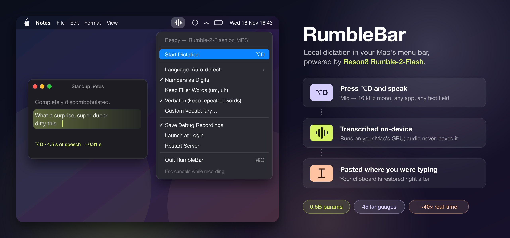

# RumbleBar



A macOS menu bar dictation app that runs [Reson8/Rumble-2-Flash](https://huggingface.co/Reson8/Rumble-2-Flash)
(0.5B, 45 languages, Apache 2.0) fully locally on Apple Silicon.

Press **⌥D** to start dictating, **⌥D** again to transcribe and paste into the
focused app, or **Esc** to cancel.

## Setup

```bash
./scripts/setup.sh   # uv venv + torch/transformers + model download (~1 GB)
./build.sh           # compiles and signs RumbleBar.app
open RumbleBar.app
```

On first launch, grant **Microphone** and **Accessibility** access. Accessibility
is needed only to paste. Without it, the transcript is left on the clipboard.

`build.sh` signs the app with your first `Apple Development` identity so macOS
keeps those permissions across rebuilds. Override this with
`RUMBLEBAR_CODE_SIGN_IDENTITY="..."`, or set `RUMBLEBAR_ALLOW_ADHOC_SIGNING=1`.

## How it works

```
RumbleBar.app (Swift, app/RumbleBar.swift)
  ├─ ⌥D / Esc global hotkeys (Carbon RegisterEventHotKey)
  ├─ AVAudioEngine → 16 kHz mono float32
  ├─ POST http://127.0.0.1:8765/transcribe  ──►  server/rumble_server.py
  │                                               (transformers on MPS, bf16)
  └─ clipboard + ⌘V paste, then restores your previous clipboard
```

- The app launches the Python server as a child process, with `HF_HUB_OFFLINE=1`.
  The server exits on its own if the app goes away.
- The model loads in under a second from the local cache, plus a warmup pass.
- Recordings up to 4 min are transcribed in a single pass. Longer audio is split
  at the quietest point near each 3-minute mark.
- `POST /transcribe` requires an `X-Rumble-Client` header. Browsers must preflight
  custom headers, so web pages can't send audio to the local server.

## Performance

Measured on an Apple M4 Pro (MacBook Pro), bf16 on MPS. Each figure is the
median of 5 warm runs, timing the model only (excluding HTTP and audio decoding).

| Audio length | Transcription time | Real-time factor (RTFx) |
|---|---|---|
| 8.3 s | 0.21 s | **39×** |
| 80 s | 1.83 s | **44×** |
| 5 min 20 s (2 chunks) | 8.27 s | **39×** |

In practice that's about **40× faster than real time**: a typical 5–10 second
dictation is pasted about a quarter of a second after you stop.

## Menu options

| Option | Effect |
|---|---|
| Language | Auto-detect (default) or force one of the model's languages |
| Numbers as Digits | `digits` control token (on: "18", off: "eighteen") |
| Keep Filler Words | `filler` (keeps "um", "uh") |
| Verbatim | `verbatim` (off collapses repeated words) |
| Custom Vocabulary | Text added to the system prompt to bias recognition toward names and jargon |
| Save Debug Recordings | Saves a WAV and TXT pair per dictation in `~/Library/Application Support/RumbleBar/Debug Recordings/` |

Server log: `~/Library/Logs/RumbleBar/server.log`.

## Using the server directly

```bash
.venv/bin/python server/rumble_server.py --port 8765
curl -H 'X-Rumble-Client: 1' -H 'Content-Type: audio/wav' \
     --data-binary @clip.wav 'localhost:8765/transcribe?language=English&digits=0'
```

The server accepts PCM WAV (int16/int32/float32, any sample rate, any channel
count) or raw little-endian float32 mono at 16 kHz.

## License

MIT for this app. The Rumble-2-Flash model weights are Apache 2.0 (see the [model card](https://huggingface.co/Reson8/Rumble-2-Flash)).
